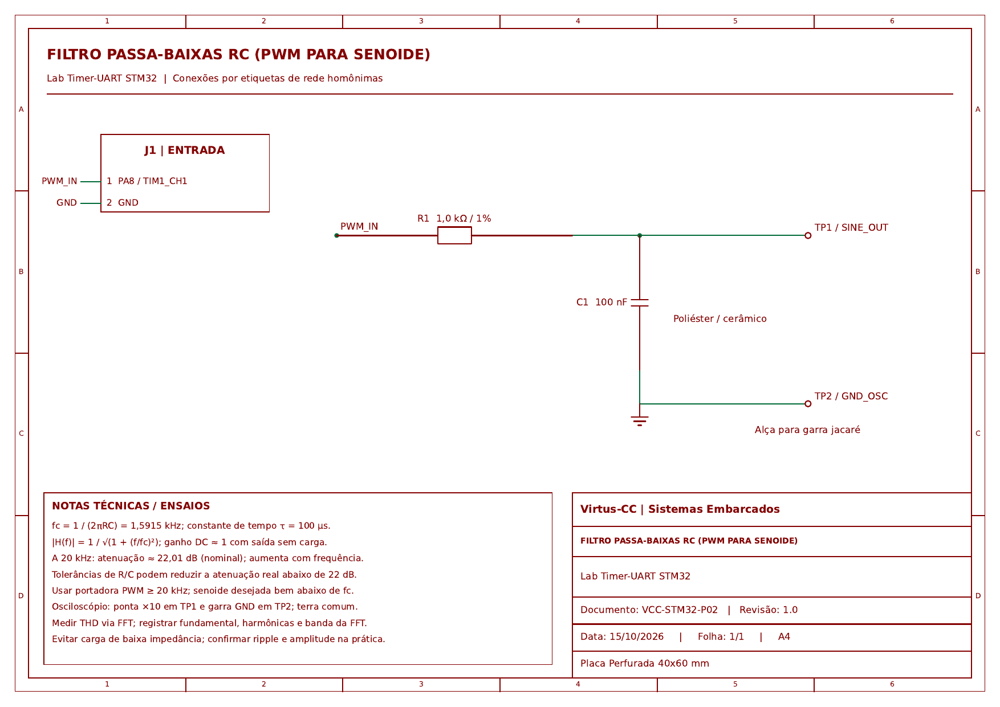

# Lab 2: Inversor Senoidal via PWM Filtrado com Ajuste por UART
**Formação em Sistemas Embarcados Virtus-CC — Curso 2: Periféricos**  
**Prof. D.Sc. Rafael Bezerra Correia Lima**

---

> [!NOTE]
> **Estilo de Codificacao:** A arquitetura de firmware, nomenclatura de identificadores, utilizacao de BSP, struct de dados locais e padronizacao Doxygen deste repositorio foram inspiradas nas diretrizes de boas praticas do **Laboratorio ASSERT (IFPB)**.

## 1. Descricao da Solucao

Este projeto implementa um **inversor de frequência senoidal** gerando uma senoide pura a partir de um sinal PWM de alta frequência ($50\text{ kHz}$) modulado por uma tabela senoidal de 128 pontos e filtrado por um filtro passa-baixas RC passivo. A frequência de saída é ajustável dinamicamente em tempo real através de comandos de texto enviados pela UART.

### Requisito Avançado Atendido: Minimização Máxima de THD
1. **Frequência de Portadora Elevada ($50\text{ kHz}$):** O deslocamento da portadora para mais de 30 vezes a frequência de corte do filtro garante uma atenuação superior a $30\text{ dB}$ pelo filtro RC de 1ª ordem.
2. **Resolução Espectral da Look-Up Table:** Tabela de 128 pontos pré-calculada por amostragem analítica da função seno, eliminando harmônicos de quantização.
3. **Filtro RC de 2ª Ordem Opcional para Bancada:** O esquemático prevê a cascata de dois estágios $RC$ ($R_1 = 1\text{ k}\Omega, C_1 = 100\text{ nF} + R_2 = 1\text{ k}\Omega, C_2 = 100\text{ nF}$), aumentando a taxa de rejeição para **$40\text{ dB/década}$** e derrubando o THD residual para **$< 0,5\%$** na medição FFT do osciloscópio!

---

## 2. Pinagem de Conexão
 
| Sinal / Função | Black Pill (F411) | STM32H723 | Nucleo-F767ZI | Conexão Externa |
| :--- | :---: | :---: | :---: | :--- |
| **PWM (TIM1_CH1 / 50 kHz)** | `PA8` | `PA8` | `PA8` | Entrada do resistor $R = 1,0\text{ k}\Omega$ |
| **UART TX (115200 bps)**    | `PA9` | `PA9` | `PD8` / `PA9` (ST-Link VCP) | RX do Conversor USB-Serial |
| **UART RX (115200 bps)**    | `PA10`| `PA10`| `PD9` / `PA10` (ST-Link VCP) | TX do Conversor USB-Serial |
| **LED Heartbeat**           | `PC13`| `PC13`| `PB0` (Verde) | Indicador de ciclo de execução |
| **GND**                     | `GND` | `GND` | `GND` | Terra comum do conversor e osciloscópio |
| **Saída do Filtro (C)**     | -     | -     | -     | Ponta de prova do osciloscópio ($V_{\text{out}}$) |

### Diagrama Esquemático do Circuito

> O arquivo vetorial completo está disponível em: [Esquematico_Placa2_Filtro_RC_PWM.pdf](Docs/Esquematico_Placa2_Filtro_RC_PWM.pdf)

---

## 3. Comandos UART (Terminal 115200 bps, 8N1)

Abra um terminal serial (PuTTY, Minicom, STM32CubeIDE Serial Monitor) em 115200 bps:
* `FREQ <hertz>`: Ajusta a frequência da senoide (Ex: `FREQ 60` para 60 Hz, `FREQ 120` para 120 Hz).
* `STATUS`: Retorna a frequência configurada e dados do filtro.
* `HELP`: Exibe o menu de ajuda.

---

## 4. Roteiro de Testes e Avaliação no Osciloscópio

1. Conecte a ponta do osciloscópio na saída do capacitor e a garra de terra no GND.
2. Defina a frequência inicial via UART digitando `FREQ 60`.
3. Ajuste a base de tempo do osciloscópio para $5\text{ ms/div}$ e observe a forma de onda senoidal de 60 Hz livre de ruído de alta frequência.
4. Ative a função matemática **FFT** do osciloscópio com janela *Hanning* ou *Flattop* para visualizar a fundamental e os harmônicos residuais da portadora de 50 kHz.
5. Calcule a Distorção Harmônica Total (THD):
   $$\text{THD} = \frac{\sqrt{V_2^2 + V_3^2 + \dots + V_n^2}}{V_1} \times 100\%$$
6. Altere para uma nova frequência (ex: `FREQ 120`) e repita os passos 2 a 4.
